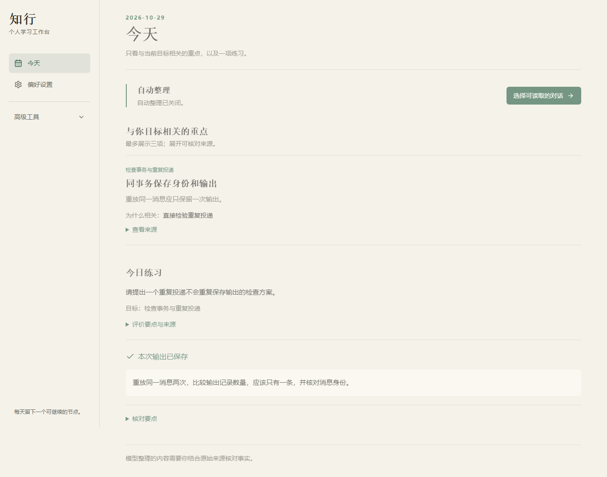

# 飞书学习入口验收（2026-10-29）

0.3.0 的第一步是飞书私聊投递当前练习、保存回答，并在知行网页查看同一条记录。Codex 完成架构、后端和集成验证；前端及其需求测试由实际 Kimi CLI 四轮实现，包括网页上的私聊入口与二维码。

| 范围 | 结果 |
| --- | --- |
| 完整后端 | 399/399 通过，无跳过；源码副本，不含个人数据，单测试进程串行运行 |
| 根项目前端 | 174/174 通过，含真实本地 HTTP 合约 |
| Kimi 隔离前端 | 173/173 通过，另有类型、构建和差异检查 |
| 启动与打包 | 35/35 通过 |
| 生产构建 | TypeScript 与 Vite 通过，构建到独立临时目录后再部署 |
| 浏览器闭环 | 10/10 通过，本机 Edge、真实 HTTP/SQLite、合成注册与消息适配器 |

浏览器确认：打开设置不自动授权；显式点击后显示本地二维码；注册完成后刷新当前应用的私聊链接，手机入口二维码按需展开；绑定只投递一次当前题目；重复私聊回答只保存一次；网页显示同一条输出与本地反馈；刷新不重复授权或提交；暂停提醒不调用模型；移动端无横向溢出。测试中模型调用为零。Playwright 的配套内核未安装，改用已安装的 Edge，无需下载浏览器。

[合成账号的移动端设置](images/feishu-mobile-20261029.png)。截图不含个人学习材料或真实凭据。

## 关键边界

- 配对仅接受一次性有效码和当前应用的个人私聊；陌生人、群、机器人及旧连接事件不写入学习记录。
- inbox 与回答同事务保存；断线恢复不重复生成回答或调用模型。出站使用稳定 UUID，结果未知时不盲目重发。
- 发送途中修改提醒时间不丢失已送达题目的回答关联；关闭、换绑定、换应用或改变来源仍拒绝旧题提交。
- 扫码准备三十秒超时；二维码到期、取消、配置变化与迟到回执受到隔离。相同值的明确关闭也不会被扫码成功重新开启。
- 未说明帮助程度记为 unknown；新旧备份可保留该状态，不能当作独立完成证据。
- 应用配置、消息通道和实际发布权限分别判断；扫码完成不表示已经具备收发能力。

## 实机范围

本机已部署 0.3.0，升级前后的档案、对话范围、模型、旧调度、调用计数和知识数量经只读检查保持一致。用户完成真实扫码后，应用凭据保存在本机；飞书长连接建立，私聊已绑定，真实绑定消息已接收、确认消息已取得平台 message_id，待发队列为空且无错误。用户设置的 12:00 提醒时间保持。平台确认投递不等同于用户已读。

首次实机扫码校验曾误用认证接口域名作为二维码域名；实际返回为 `open.feishu.cn/page/launcher`。核对官方实现并补充精确官方域名、拒绝通配来源后，回归与真实扫码通过。凭据与 URL 的敏感参数未写入源码。

当前档案修订为 4，自动整理当日三次额度已用完，尚无有效当前练习；未注入测试题、重置额度或强制额外模型请求。因此实机已经验证授权、私聊绑定及确认消息收发，完整练习回答闭环仍以合成浏览器验证为证；不把这些结果当成长效学习改善的证明。

升级前已创建一致性 SQLite 快照及用户专属 ACL 的凭据副本。原手动实验对照 `control-manual-v0.1.0-20261028` 和自动整理版本 `v0.2.0` 保持不动。日常接入步骤见 [使用说明](FEISHU-CHAT.md)，长期能力见 [路线草案](CHAT-CHANNEL-DIRECTION.md)。
