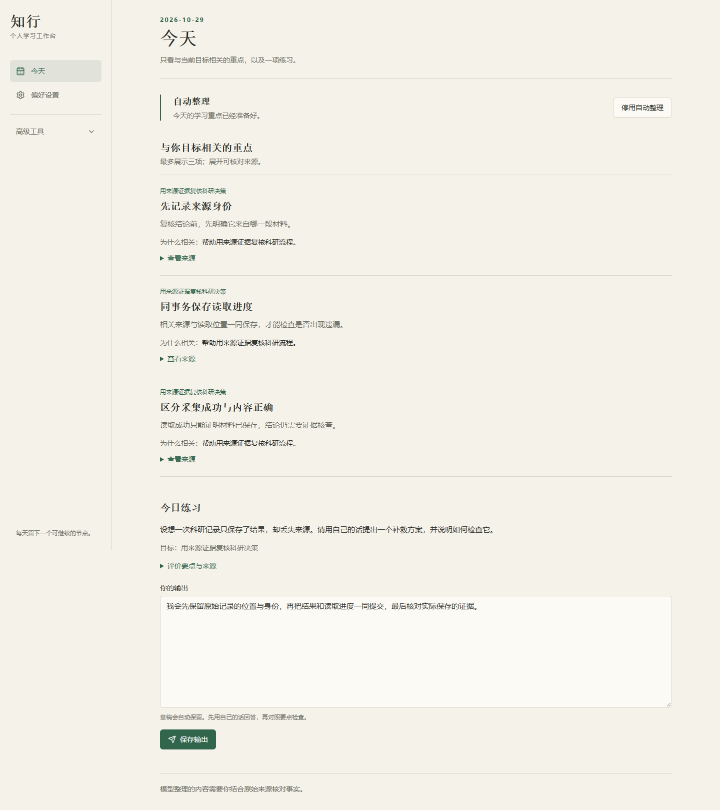

# 简化版 0.2.0 验收（2026-10-29）

目标是减少日常管理操作：一次开启自动整理，后台接续已授权对话，首页最多三个目标相关重点和一道直接作答的练习。Codex 实现架构、后端和集成；前端源码与前端需求测试由实际 Kimi CLI 完成。

## 自动验证

Windows、Node 24.22.0，本机 Codex CLI 0.165.0。

| 范围 | 结果 |
| --- | --- |
| 完整后端 | 333/333 通过，无跳过；不含个人数据的源码副本，单测试进程串行运行 |
| 完整前端 | 114/114 通过，含真实本地后端 HTTP 合约 |
| Kimi 隔离前端 | 113/113 通过，另有 typecheck、build 和差异检查 |
| 启动器与打包 | 35/35 通过 |
| 生产构建 | TypeScript 与 Vite 构建通过 |
| 浏览器 | 8/8 通过，真实页面、HTTP 与 SQLite，合成 RPC 和模型 |

浏览器验证：页面打开不采集或调用模型；一次开启后生成三个带引用的重点和一道练习；后台自动接续，正在写的草稿保持；只保存一次回答并自动取得默认折叠的本地自查提示；刷新恢复提交记录；旧工具保留；移动端无横向溢出；关闭后保存结果仍在。模型测试引用来自合成材料，不是个人学习资料。

跨日安排另由后端场景覆盖：优先安排未安排过的有效重点，再回顾最久未安排的重点；同日内容稳定，历史输出保留，此步骤不增加模型调用。

[移动端截图](images/simple-mobile-20261029.png)

## 实机有界验证

沿用已有档案、六个对话授权、模型配置及每日 15 分钟预算，开启自动整理。首个请求发生连接故障，计为一次尝试；只读模型列表查询确认凭据有效、所选模型可用。随后加入且验证了一次有界连接恢复规则：失败不清账，短重试仍预留额度，连续失败恢复长间隔。

在不改动档案、授权或模型配置的情况下，自动恢复成功：**三个重点、一项练习、当日两次尝试、无当前错误**。重点均指向已保存目标并保留来源，摘要均在 200 个 Unicode 字符内；没有新增逐条回答摘录草稿。第一次失败仍计入次数，没有清零。

最终重启核对时，学习档案已经由修订 2 变为修订 3；旧重点按有效性规则隐藏，自动整理保持开启，费用账本仍为两次，等待正常冷却后按新档案整理。只读元数据核对确认原来源未变化；未回滚档案、重置额度或强制额外请求。此前成功生成的结果与此次等待状态分别记录，不能把旧结果视为新档案的验收结果。

已运行服务为 0.2.0，知行回环端口 18997、专用思源端口 19006；未添加系统自动启动。源数据库、凭据、对话、恢复与对照快照、Kimi 原始日志和实际验证原始记录均留在本机，不纳入源码仓库。

## 对照与结论边界

原手动版固定于 [control-manual-v0.1.0-20261028](https://github.com/b55585wy/second-brain/releases/tag/control-manual-v0.1.0-20261028)，提交 `1f21d7b`；本地保留一致性数据库快照供后续受控比较。

这些结果证明工作流和约束可运行，不证明已经完成全部历史提炼、事实核验或长期学习效果提升。模型建议需结合来源判断；首页的本地自查提示不自动判分。是否降低主观负担并保持学习表现，按 [研究方案](CHI-RESEARCH-PLAN.md)另行验证。
